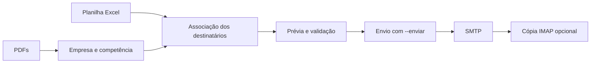

# Envio de relatórios em lote por e-mail

Automação em Python que identifica a empresa e a competência pelo nome de cada PDF, consulta os destinatários em uma planilha Excel e envia os relatórios com assinatura personalizada. O lote reutiliza uma conexão SMTP e pode salvar as mensagens na pasta **Enviados** por IMAP.

O projeto nasceu de uma necessidade de um escritório de contabilidade: reduzir o trabalho repetitivo de localizar contatos, preparar mensagens e anexar o relatório correto para cada cliente. Esta versão pública foi reconstruída com **dados fictícios**, sem documentos, contatos, credenciais ou identidade visual do projeto corporativo.

## Resultados no cenário original

**13 relatórios em 4 min 16 s**, conforme medição informada pelo autor da versão original.

Como referência manual, um colaborador relatou levar aproximadamente **15 minutos**, depois de organizar empresas, textos e arquivos. Considerando que essa referência corresponda ao mesmo lote de 13 relatórios:

| Indicador | Resultado |
| --- | ---: |
| Envio automático | 4 min 16 s |
| Referência manual relatada | Aproximadamente 15 min |
| Economia estimada por lote | 10 min 44 s |
| Redução estimada do tempo | **71,6% — aproximadamente 72%** |
| Fator de velocidade estimado | **3,5 vezes** |

Um teste real anterior com **2 relatórios** registrou **53,3 segundos** de execução completa, incluindo processamento, autenticação, envio SMTP e cópia IMAP.

> O tempo manual foi relatado, não cronometrado, e não inclui a organização prévia. A comparação de 72% depende de os 15 minutos corresponderem ao mesmo volume de trabalho. A configuração inicial da automação e a preparação dos dados também ficam fora da comparação. Os resultados do cenário original não foram reproduzidos com os dados fictícios deste repositório.

A redução é calculada por `(tempo manual − tempo automático) ÷ tempo manual × 100`. O tempo de execução não confirma leitura nem mede quando a mensagem chega à caixa do destinatário. Rede, servidor e tamanho dos anexos afetam o desempenho.

## Funcionalidades

- Prévia com empresa, competência, cadastro e destinatários antes do envio.
- Associação por razão social, com normalização de acentos, pontuação e sufixos `ME/EPP`.
- Leitura de até três campos de e-mail por cliente e remoção de endereços repetidos.
- Validação de pendências antes de iniciar o lote.
- Mensagens em texto e HTML, assinatura incorporada por CID e PDF anexado.
- Conexão SMTP reutilizada, registro IMAP opcional e tempos no terminal.
- Demonstração local com Mailpit e testes automatizados no GitHub Actions.

## Fluxo



A identificação usa **o nome do arquivo**, sem ler o conteúdo interno do PDF. Cada PDF gera uma mensagem. Clientes cadastrados sem relatório não recebem mensagem.

## Executar a demonstração

Requisitos: **Python 3.10 ou superior**. Docker com Compose é necessário para a caixa de teste Mailpit; a prévia funciona sem Docker.

### 1. Preparar o ambiente

Na raiz do projeto, em Linux ou macOS:

```bash
python3 -m venv .venv
source .venv/bin/activate
python -m pip install -r requirements.txt
cp .env.example .env
```

No Windows PowerShell, ative com `.venv\Scripts\Activate.ps1` e copie o modelo com `Copy-Item .env.example .env`.

Os dados de demonstração incluem **16 clientes**, **13 relatórios** e uma assinatura da empresa fictícia Alfa Contábil. Para recriá-los:

```bash
python scripts/gerar_dados_ficticios.py
```

O gerador substitui a planilha, a assinatura e todos os PDFs da pasta `arquivos/`. Use-o somente com os dados demonstrativos.

### 2. Conferir sem enviar

```bash
# Todos os relatórios
python src/enviar_relatorios.py

# Somente Academia Corpo em Forma e Clínica Sorriso Feliz
python scripts/testar_relatorios.py
```

Sem `--enviar`, o programa não abre conexões SMTP ou IMAP.

### 3. Enviar para o Mailpit local

```bash
docker compose up -d
python scripts/testar_relatorios.py --enviar
# Ou envie o lote completo:
python src/enviar_relatorios.py --enviar
```

Abra **http://localhost:8025** para conferir mensagens, anexos e assinatura. Com o `.env` de exemplo, o SMTP aponta para o Mailpit em `localhost:1025`, sem entrega externa. As portas do contêiner ficam acessíveis apenas pela máquina local.

Para encerrar a caixa de teste:

```bash
docker compose down
```

## Formato dos dados

### Relatórios

São aceitos os dois padrões:

```text
Relatório ACADEMIA CORPO EM FORMA LTDA - Setembro 2026.pdf
RELATÓRIO SIMPLES NACIONAL 09 2026 - ACADEMIA CORPO EM FORMA LTDA.pdf
```

No primeiro padrão, o tipo de relatório é considerado `SIMPLES NACIONAL`. A empresa, o mês e o ano são extraídos do nome.

### Planilha

A primeira aba deve conter:

| Coluna | Uso |
| --- | --- |
| `RAZÃO SOCIAL` | Associação com o nome da empresa no PDF |
| `E-MAIL - 1` | Primeiro destinatário |
| `E-MAIL - 2` | Destinatário adicional |
| `E-MAIL - 3` | Destinatário adicional |

Os três campos de e-mail devem existir; células vazias ou `-` são ignorados. A coluna `CPF/CNPJ` da demonstração não é usada na associação.

O programa procura uma única planilha `.xlsx` em `arquivos/`; na ausência dela, usa `dados/clientes.xlsx`. Para escolher outros caminhos:

```bash
python src/enviar_relatorios.py --pasta caminho/dos/pdfs --planilha caminho/clientes.xlsx
```

Nomes abreviados são aceitos quando o cadastro é um prefixo de pelo menos três palavras completas e existe uma única correspondência. Confira o cadastro na prévia, principalmente em empresas com filiais ou nomes semelhantes. Cadastros idênticos com os mesmos destinatários são consolidados; correspondências conflitantes bloqueiam o lote.

## Configuração

As configurações são lidas do `.env` na raiz. Variáveis já definidas no ambiente têm prioridade.

| Variável | Finalidade |
| --- | --- |
| `SMTP_HOST` / `SMTP_PORT` | Servidor e porta SMTP |
| `SMTP_USER` / `SMTP_PASSWORD` | Remetente e autenticação |
| `SMTP_STARTTLS` | STARTTLS para conexões que não usam a porta 465 |
| `SAVE_TO_SENT` | Habilita a cópia em Enviados por IMAP |
| `IMAP_HOST` / `IMAP_PORT` | Servidor IMAP; padrão é o host SMTP e porta 993 |
| `IMAP_USER` / `IMAP_PASSWORD` | Credenciais IMAP; por padrão, usa as de SMTP |
| `IMAP_SENT_FOLDER` | Pasta de destino; quando omitida, tenta identificação automática |

Na demonstração local, `SMTP_STARTTLS=false` e `SAVE_TO_SENT=false`. Para uma conta real, configure o servidor e os destinatários próprios; normalmente a porta 587 usa STARTTLS, enquanto a porta 465 usa SSL. O IMAP usa SSL.

## Testes

```bash
python -m pytest -q
```

A versão preparada passou em **11 testes**, cobrindo identificação, normalização, associação com a planilha, ausência de e-mail, mês inválido, prévia sem conexões, assinatura incorporada e reutilização SMTP. O teste de integração envia os 13 relatórios a um servidor SMTP falso em `127.0.0.1`, sem entrega externa.

O GitHub Actions executa a suíte em Python 3.10 e 3.12. O envio depende de `smtplib` e das bibliotecas MIME da biblioteca padrão; `openpyxl` lê o Excel e `python-dotenv` lê a configuração. ReportLab e Pillow geram os dados demonstrativos; pytest e aiosmtpd apoiam os testes.

## Estrutura

```text
.github/workflows/tests.yml       testes no GitHub Actions
src/enviar_relatorios.py          identificação, validação e envio
scripts/testar_relatorios.py      teste com dois clientes fictícios
scripts/gerar_dados_ficticios.py   geração dos dados demonstrativos
tests/test_enviar_relatorios.py   testes unitários e de integração
dados/clientes.xlsx               cadastro fictício
arquivos/                        PDFs fictícios
assets/assinatura_demo.png        assinatura fictícia
.env.example                     modelo sem credenciais reais
docker-compose.yml               Mailpit local
requirements.txt                 dependências
```

## Limitações e cuidados

- O lote é sequencial e não mantém histórico persistente contra duplicidade. Reexecutar `--enviar` envia novamente.
- Uma falha SMTP interrompe o lote; mensagens anteriores podem já ter sido aceitas.
- Uma falha IMAP gera um aviso separado. Não repita o envio apenas para salvar a cópia.
- O SMTP aceitar a mensagem não comprova entrega ou leitura.
- Os documentos, identificadores e contatos são exemplos demonstrativos, sem valor fiscal. Os domínios usados são de exemplo.
- O `.env` contém configuração privada e é ignorado pelo Git. Não publique credenciais, planilhas ou documentos de clientes reais.

## Próximas melhorias

- Histórico persistente dos envios e prevenção de duplicidade.
- Exportação dos resultados e tempos para CSV.
- Retomada de mensagens que falharam, sem repetir as já enviadas.

## Publicar no GitHub

Crie um repositório vazio chamado `envio-relatorios-em-lote`. Depois, nesta pasta:

```bash
git init -b main
git add .
git status
# Confira que .env e .venv não aparecem entre os arquivos preparados.
git commit -m "Versão inicial com dados fictícios e testes"
git remote add origin https://github.com/SEU_USUARIO/envio-relatorios-em-lote.git
git push -u origin main
```

**Descrição sugerida:** Automação em Python para associar PDFs a clientes em Excel e enviar relatórios por e-mail, com prévia, assinatura e testes locais.

**Tópicos:** `python`, `automation`, `smtp`, `excel`, `pdf`, `mailpit`, `pytest`.

O projeto ainda não inclui licença de distribuição. Adicione uma licença caso queira conceder permissões explícitas de reutilização.
